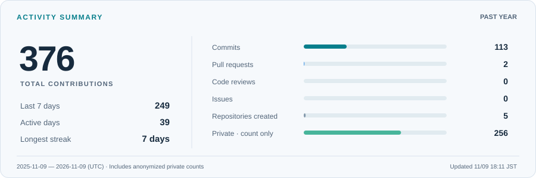
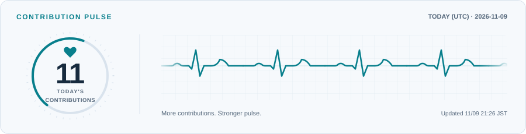

<picture>
  <source media="(prefers-color-scheme: dark)" srcset="./assets/header-dark.svg">
  <source media="(prefers-color-scheme: light)" srcset="./assets/header-light.svg">
  
</picture>

## 👋 About Me

I build apps that connect body movement, music, and heart-rate data.

- 📷 **Computer Vision** — Visualizing human motion and comparing pose estimation models
- 🎮 **Interactive Games** — Turning body movement into game controls and exploring AI-generated music
- 💓 **Web / macOS Apps** — Working with heart-rate data in web apps and native macOS apps built with SwiftUI

## 🧰 Tech Stack

**Web / macOS Development**

**Computer Vision / Games**

**AI Tools / Editors**

  
More tools

  <table>
    <thead><tr><th scope="col">Area</th><th scope="col">Tools</th></tr></thead>
    <tbody>
      <tr><th scope="row">AI Assistants</th><td>Claude · ChatGPT · Cursor</td></tr>
      <tr><th scope="row">LLM Inference</th><td>TensorRT-LLM · vLLM · Ollama</td></tr>
      <tr><th scope="row">Vision, Audio &amp; Data</th><td>Ultralytics YOLO · Transformers · MusicGen · librosa · NumPy</td></tr>
      <tr><th scope="row">Web Development</th><td>JavaScript · HTML5 · CSS · React · Next.js · Vite · Node.js</td></tr>
      <tr><th scope="row">Databases &amp; Cloud</th><td>SQLite · PostgreSQL · Google Cloud</td></tr>
      <tr><th scope="row">Testing</th><td>Vitest · Playwright · pytest</td></tr>
      <tr><th scope="row">Development Environment</th><td>Docker · Git · GitHub Actions · Linux · macOS</td></tr>
      <tr><th scope="row">Research &amp; Writing</th><td>MATLAB · LaTeX · Overleaf · Notion · Obsidian</td></tr>
      <tr><th scope="row">3D Graphics</th><td>Blender</td></tr>
    </tbody>
  </table>

## ⚡ Activity Summary

<picture>
  <source media="(prefers-color-scheme: dark)" srcset="./assets/overview-dark.svg">
  <source media="(prefers-color-scheme: light)" srcset="./assets/overview-light.svg">
  
</picture>

## Contributions

<picture>
  <source media="(prefers-color-scheme: dark)" srcset="./assets/pulse-dark.svg">
  <source media="(prefers-color-scheme: light)" srcset="./assets/pulse-light.svg">
  
</picture>

<picture>
  <source media="(prefers-color-scheme: dark)" srcset="./assets/beat-runner-dark.svg">
  <source media="(prefers-color-scheme: light)" srcset="./assets/beat-runner-light.svg">
    
</picture>

---

<i>Motion. Rhythm. Code.</i>

