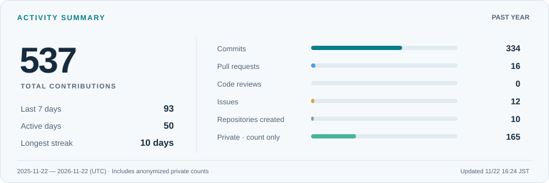
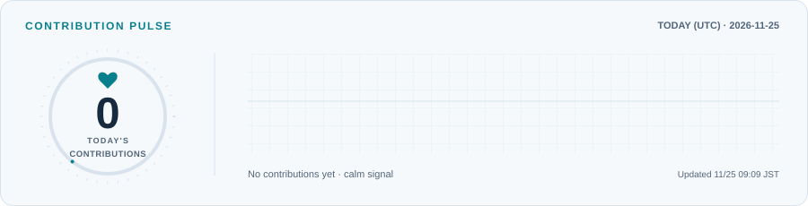

<picture>
  <source media="(prefers-reduced-motion: reduce) and (prefers-color-scheme: dark)" srcset="./assets/header-dark-still.svg">
  <source media="(prefers-reduced-motion: reduce)" srcset="./assets/header-light-still.svg">
  <source media="(prefers-color-scheme: dark)" srcset="./assets/header-dark.svg">
  
</picture>

## About Me

I build apps that connect body movement, music, and heart-rate data.

- 📷 **Computer Vision** — Visualizing human motion and comparing pose estimation models
- 🎮 **Interactive Games** — Turning body movement into game controls and exploring AI-generated music
- 💓 **Web / macOS Apps** — Working with heart-rate data in web apps and native macOS apps built with SwiftUI

## Tech Stack

### Languages

### Web / macOS Development

### Computer Vision / Games

### AI Tools / Editors

<a href="https://www.onorca.dev/"><picture><source media="(prefers-color-scheme: dark)" srcset="./assets/mini-orca-dark.png"></picture></a>

  
More tools

-  **AI Assistants** — Claude · ChatGPT · Cursor
-  **LLM Inference** — TensorRT-LLM · vLLM · Ollama
-  **Vision, Audio & Data** — Ultralytics YOLO · Transformers · MusicGen · librosa · NumPy
-  **Web Development** — JavaScript · HTML5 · CSS · React · Next.js · Vite · Node.js
-  **Databases & Cloud** — SQLite · PostgreSQL · Google Cloud
-  **Testing** — Vitest · Playwright · pytest
-  **Development Environment** — Docker · Git · GitHub Actions · Linux · macOS
-  **Research & Writing** — MATLAB · LaTeX · Overleaf · Notion · Obsidian
-  **3D Graphics** — Blender

## Activity Summary

<picture>
  <source media="(prefers-color-scheme: dark)" srcset="./assets/overview-dark.svg">
  
</picture>

## Contributions

<picture>
  <source media="(prefers-color-scheme: dark)" srcset="./assets/pulse-dark.svg">
  
</picture>

<picture>
  <source media="(prefers-reduced-motion: reduce) and (prefers-color-scheme: dark)" srcset="./assets/beat-runner-dark-still.svg">
  <source media="(prefers-reduced-motion: reduce)" srcset="./assets/beat-runner-light-still.svg">
  <source media="(prefers-color-scheme: dark)" srcset="./assets/beat-runner-dark.svg">
  
</picture>

---

<i>Motion. Rhythm. Code.</i>

